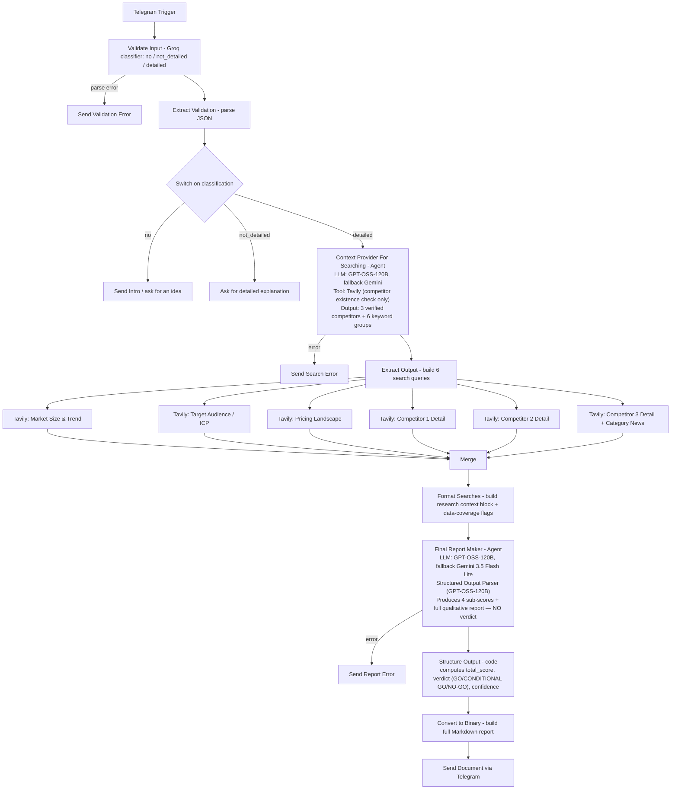

# Idea Validator

A Telegram bot that takes a startup/product/business idea in plain English and returns a full structured validation report as a downloadable Markdown file — score breakdown, GO/CONDITIONAL GO/NO-GO verdict, market sizing (TAM/SAM/SOM), ICP, competitor analysis (with real, search-verified competitors), business model, GTM strategy, risks, assumptions, and next steps.

## What it does

1. You send an idea (e.g. "An app where students upload their notes and AI generates personalized quizzes").
2. An LLM classifies the message as `no` (not an idea), `not_detailed` (idea, but too vague to validate), or `detailed`. Only `detailed` proceeds — the other two get a matching Telegram reply asking for a real idea or more detail.
3. A research-planning agent identifies exactly 3 real competitors (verified via a Tavily "does this actually exist" tool call, not invented) and generates 6 fixed groups of search queries: market size/trend, target audience/ICP, pricing landscape, and one detail search per competitor (the third also covering recent category funding/traction news).
4. Those 6 queries run as parallel Tavily searches, get merged, and are formatted into one research context block — tracking which sections actually returned live data.
5. A second AI Agent, given ONLY that research context (explicitly barred from inventing facts), produces the 4 sub-scores (market potential, execution difficulty, differentiation, risk level — all 0–25) plus the full qualitative report (strengths, weaknesses, competitors, business model, GTM, risks, assumptions, next steps, sources) as schema-enforced JSON. It does **not** compute the final verdict.
6. A Code node computes the total score and verdict deterministically (`>=70` GO, `>=40` CONDITIONAL GO, else NO-GO) and derives a confidence level from whether the market and competitor searches actually returned data — score/verdict/confidence are never left to the LLM.
7. The structured data is rendered into a full Markdown report and sent back as a Telegram document.

## Flow diagram

## Tech stack

| Component | Role |
|---|---|
| n8n | Orchestration |
| Telegram Bot API | Trigger + replies + document delivery |
| Groq (`openai/gpt-oss-20b`, `openai/gpt-oss-120b`) | Input classification, research planning agent, report-writing agent, structured-output parsing |
| Google Gemini (`gemini-3.5-flash`, `gemini-3.5-flash-lite`) | Fallback LLM for both agents |
| Tavily Search API | Competitor existence verification (planning stage) + 6 parallel research searches (market, ICP, pricing, 3× competitor detail) |
| n8n LangChain Agent + Structured Output Parser (×2) | Schema-enforced JSON for both the research plan and the final report |

## Prerequisites

- n8n with LangChain and Tavily community nodes installed.
- A Telegram bot token.
- A Groq API key.
- A Google AI Studio (Gemini) API key.
- A Tavily API key.

## Setup

1. Import `Idea_Validator.json` into n8n.
2. Attach credentials (they arrive unlinked — secrets are never exported):
   - `telegramApi` → **Trigger**, **Send Intro**, **Ask Detailed Explanation**, **Send Validation Error Message**, **Send Search Error Message**, **Send Report Error Message**, **Send a document**
   - `groqApi` → **Validate Input**, **GPT-OSS-120B**, **GPT-OSS-20B**, **GPT-OSS-120B2**, **GPT-OSS-120B3**
   - `googlePalmApi` → **FLASH-3**, **FLASH-3.5**
   - `tavilyApi` → **Tavily** (planning-stage tool), **Market Size And Trend**, **Who Are Audience**, **Pricing**, **Competitor1**, **Competitor2**, **Competitor3**
3. Verify the Gemini model strings (`models/gemini-3.5-flash`, `models/gemini-3.5-flash-lite`) are still valid for your account.
4. Activate the workflow and send it an idea via Telegram.

## How the scoring works

The report-writing LLM only ever outputs the 4 sub-scores (0–25 each) and the qualitative content — it is explicitly instructed **not** to state a verdict. All of the following are computed deterministically in code, not by the model:

- `total_score` = sum of the 4 sub-scores (max 100)
- `verdict`: `>=70` → GO, `>=40` → CONDITIONAL GO, else → NO-GO
- `confidence`: "Medium" only if both the market-size search and at least one competitor search actually returned live results; "Low" otherwise — there's no path to "High" in this version (the code comment notes it's reserved for a future manual/stronger check)

## Notes / limitations

- The planning agent is only allowed to use its Tavily tool to confirm a competitor name is real (one call per candidate) — it is explicitly barred from using it to research market size, pricing, or competitor detail, since that's handled by the six dedicated search branches downstream.
- The report-writing agent is instructed to fill every field even when research is thin, noting uncertainty in the wording rather than leaving fields blank — so a "Low confidence" report can still read as fully populated. Read the `confidence` field, not just field completeness, when judging how much to trust a given report.
- Competitor/risk arrays are capped at exactly 3 items by both the prompt and the JSON schema (`maxItems: 3`) — not configurable without editing the schema.

